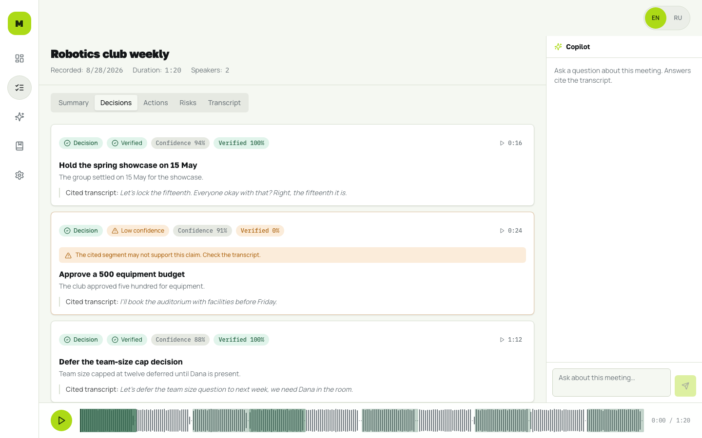
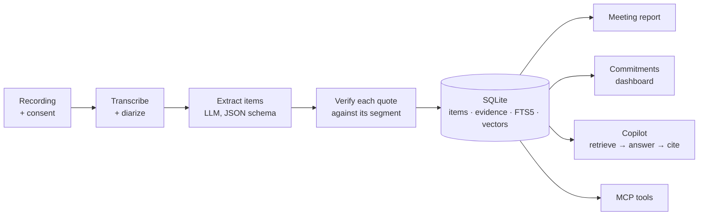

# MeetingOS

[](https://github.com/AyanbergenSaduakassov07/MeetingOS/actions/workflows/ci.yml)


**Meeting memory for small teams.** Upload a recording and MeetingOS turns it into decisions, action items, risks and commitments. Each one links to the exact second it was said. You can then ask questions across all your team's meetings and documents, and every answer cites its source.

<p align="center">
  
</p>

## Why

Meeting notes fail in two ways: nobody writes them, or they say things nobody said. MeetingOS is built around a single rule: **no claim without a quote.** If the model extracts a decision but the transcript doesn't support it, the card says so in orange instead of presenting it as fact.

## Features

| | |
|---|---|
| **Evidence-first extraction** | Decisions, actions, risks and commitments each carry a quote, a timestamp and a verification score. Click the timestamp and the player jumps there. |
| **Commitments tracker** | "I'll send it by Friday" becomes an owner, a due date and an overdue flag, collected across every meeting. |
| **Org copilot** | Ask "what did we decide about the venue?" and get an answer built only from retrieved excerpts, with citations. When the meetings never covered it, the copilot says so. |
| **Decision timeline** | Follows one decision across meetings and flags when two meetings contradict each other. |
| **Prep briefs** | Before a meeting: the attendees' open items, unresolved decisions and what changed since the last related meeting. |
| **Board mode** | Resolutions with mover and seconder, dissents, financial implications, and generated minutes. |
| **Documents** | Contracts and notes share one search index with the transcripts. Documents marked sensitive are redacted before indexing. |
| **Bilingual** | English and Russian interface. Transcripts and quotes stay in the language they were spoken in. |
| **MCP server** | Claude Code, Cursor or any other MCP client can read meetings and commitments and ask the copilot. |

## How it works



Every extracted item points to an **Evidence** row: the claim, the verbatim quote, the transcript segments it cites, and a verdict on whether those segments support it. The verifier runs after extraction, so a confident-sounding hallucination still lands as `low_confidence` or `unsupported`.

## Try it in two minutes (no API keys)

Requirements: Python 3.13, [uv](https://docs.astral.sh/uv/), [bun](https://bun.sh) and [just](https://just.systems).

```bash
just setup                  # venv, deps, .env from .env.example
just seed-demo              # a demo team and one processed meeting (into ./data)
just dev                    # API on :8470, UI on http://localhost:5173
```

Everything works on the demo meeting except asking the copilot. To process your own recordings, add one model key to `.env` (for example `ANTHROPIC_API_KEY`). For transcription, either set `OPENAI_API_KEY` for cloud Whisper or run it locally: `uv pip install -r backend/requirements-local.txt` and `TRANSCRIPTION_PROVIDER=faster_whisper`. If extraction can't run, the meeting page says so instead of showing an empty report.

### Docker

The container binds `0.0.0.0`, so it refuses to start without a key:

```bash
echo "MEETINGOS_API_KEY=$(just gen-key)" >> .env
docker compose up --build   # http://127.0.0.1:8470
```

## Privacy model

Meeting audio is personal data, so these controls are built in:

| Control | Behavior |
|---|---|
| Consent | Uploads are rejected unless the uploader confirms everyone agreed to be recorded. The confirmation is stored with the meeting. |
| Access | `MEETINGOS_API_KEY` protects the API, the MCP endpoint and the docs. The server refuses to listen on a public interface without a key. |
| Egress | Audio and text go only to allowlisted inference hosts, and every outbound call is logged on the Privacy page. Point `OPENAI_COMPATIBLE_BASE_URL` at a local model to keep everything on your machine. |
| Redaction | Optional masking of emails, phone numbers and ID numbers before text reaches a cloud model. Sensitive documents are always redacted. |
| Retention | `just purge` deletes meetings older than the organization's retention period. |

Known limits: one shared key, not per-user accounts; routes are not yet scoped per organization. Both are planned for v0.4. Full review: [docs/security](docs/security/v0.1-llm-and-privacy-review.md).

## Providers

| Job | Options (`.env`) |
|---|---|
| Language model | `AI_PROVIDER=anthropic` (default, `claude-opus-5-5`), `openai`, `openai_compatible` (Ollama, vLLM, OpenRouter) |
| Transcription | `TRANSCRIPTION_PROVIDER=whisper_cloud` (default), `assemblyai`, `faster_whisper` (local, no audio leaves the machine) |
| Embeddings | OpenAI or any OpenAI-compatible endpoint |

## Connect an agent (MCP)

Streamable HTTP MCP is served at `/mcp`. Inside this checkout, Claude Code picks up `.mcp.json` automatically. Anywhere else:

```bash
claude mcp add --transport http meetingos http://127.0.0.1:8470/mcp \
  --header "Authorization: Bearer $MEETINGOS_API_KEY"
```

| Tool | Returns |
|---|---|
| `list_meetings` | Recent meetings with status and language |
| `list_commitments` | Open commitments, optionally only overdue ones |
| `ask` | A cited answer from the org copilot |

All tools are read-only: an agent can query meetings but not change or delete them.

## Development

```bash
just check        # ruff + pytest + TypeScript typecheck
just test-web     # Playwright suites (needs `just dev` running on seeded data)
just eval-stub    # extraction scorer smoke test, no API calls
just --list       # everything else
```

CI runs lint, roughly 350 backend tests, a production web build, and the four Playwright suites against a seeded dataset on every push and pull request.

```
backend/
  routes/        HTTP edge: meetings, copilot, commitments, decisions, documents, privacy
  meetings/      pipeline: ingestion, extraction, verification, redaction, retention
  memory/        corpus index (SQLite + FTS5 + embeddings), retrieval, org copilot
  ai/            LLM providers behind one interface
  transcription/ speech-to-text providers
  mcp_server/    MCP tools
  eval/          frozen extraction cases and scorer
web/             React + Vite + Tailwind UI; Playwright suites in web/tests
docs/            roadmap, security review
```

API reference: `http://127.0.0.1:8470/docs` while the server runs.

## Roadmap

- **v0.2 Foundation** (done): auth, consent, MCP tools, Docker, browser tests in CI
- **v0.3 Measured quality**: real recorded meetings as eval cases, precision and recall per item type, published in this README
- **v0.4 Teams**: user accounts, per-organization scoping, per-user agent tokens, audit log, fully local mode
- **v1.0 Ship**: hosted demo, backup and restore, docs site

Details in [docs/ROADMAP.md](docs/ROADMAP.md).

## License

MIT, see [LICENSE](LICENSE). The original backend scaffolding came from [Voicebox](https://github.com/jamiepine/voicebox) (MIT).
